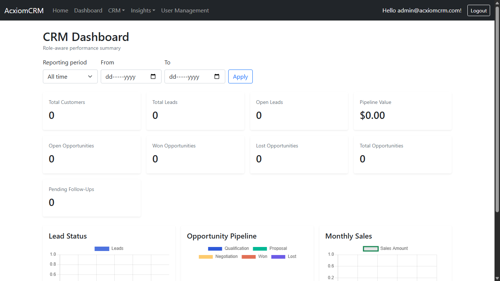
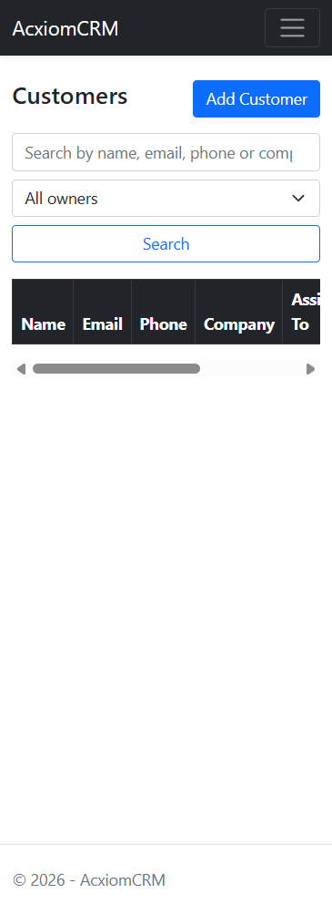
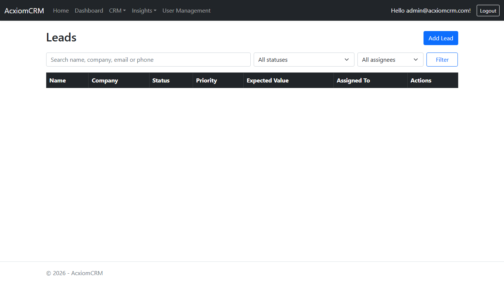
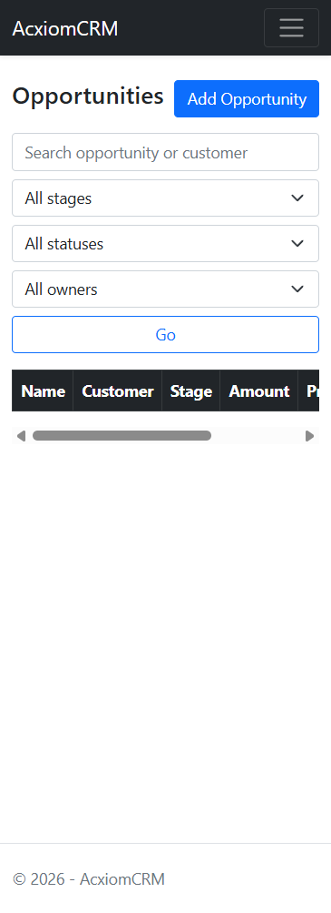

# AcxiomCRM

AcxiomCRM is a role-aware customer relationship management application for organizing customer accounts, tracking prospective business, managing sales opportunities and follow-ups, and reviewing team performance. It is built with ASP.NET Core 8 MVC, ASP.NET Core Identity, Entity Framework Core, and SQLite.

Run the application locally as described below. A development database and its accounts are not included in a fresh clone.

## Table of contents

- [What the application does](#what-the-application-does)
- [Screenshots](#screenshots)
- [Roles and access](#roles-and-access)
- [Typical CRM workflow](#typical-crm-workflow)
- [Run locally](#run-locally)
- [Run automated tests](#run-automated-tests)
- [First sign-in and user setup](#first-sign-in-and-user-setup)
- [HTTP API](#http-api)
- [Validation and security](#validation-and-security)
- [Database updates](#database-updates)
- [Project structure](#project-structure)
- [Assignment feature checklist](#assignment-feature-checklist)
- [Limitations and implementation notes](#limitations-and-implementation-notes)

## What the application does

| Area | Purpose |
|---|---|
| Dashboard | Summarizes customers, leads, opportunities, open pipeline value, weighted pipeline value, and pending follow-ups. Choose a reporting period or a custom date range. Charts show lead status, opportunity stages, and closed-won sales by month. |
| Customers | Create, search, filter, inspect, and update customer accounts, including contact/company details, status, and owner. Deactivation retains the record as inactive rather than deleting it. |
| Leads | Track prospects, source, priority, expected value, status, notes, and assigned Sales Executive. Search/filter the list, inspect lead details, and convert a qualified lead into a customer. |
| Opportunities | Link a potential sale to a customer (and optionally a lead), record its source, amount, probability, stage, owner, and expected close date, and record Won or Lost outcomes. |
| Follow-ups | Schedule calls, meetings, emails, and tasks, link them to a customer, lead, or opportunity, assign them, filter upcoming and overdue items, and track planned/completed/missed/cancelled status. |
| Activities | Record calls, meetings, emails, or tasks against a customer or lead. Filter by date, status, type, and assignee; update or remove activities that you can access. |
| User management | Admins can create users, assign one of the application roles, activate/deactivate accounts, and unlock accounts. A password-reset delivery workflow is not configured. |
| Reports | View scoped customer, lead, follow-up, opportunity, pipeline, conversion, user-activity, and audit reports. Management reports support date or assignee filters where relevant. |
| Audit log | Review recorded authentication events and changes to CRM records and user accounts. Access to sensitive values and network information is restricted to Admins. |
| HTTP API | Use authenticated JSON endpoints for login/logout, customers, leads, opportunities, follow-ups, and pipeline data. |

All of these screens are part of the same application. The main navigation groups record-management links under **CRM**, report links under **Insights**, and provides a visible **Logout** button alongside the signed-in account.

The signed-in account and **Logout** button remain available in the shared navigation.

## Screenshots

These captures show verified desktop views of the running application. They are illustrative, not seeded application data; the database used for the captures is not distributed with the repository.

### Dashboard

KPIs and charts respond to the selected reporting period and the signed-in user's data scope.



### Customer and sales lists

The customer and lead lists provide the entry points to create and manage records.

| Customers | Leads |
|---|---|
|  |  |

### Opportunities



Screenshots for follow-ups, activities, reports, and administration are omitted until valid captures are available; earlier capture attempts produced error pages and were removed.

## Roles and access

| Role | Access |
|---|---|
| **Admin** | Organization-wide CRM records and reports; user creation and administration; full audit-log details. |
| **Manager** | Organization-wide CRM records, assignment controls, management reports, and limited business-audit access. Cannot administer accounts. |
| **SalesExecutive** | Records assigned to them or associated with customers/leads they own. Dashboard, API results, activities, follow-ups, and reports are scoped accordingly. |

Public self-registration always creates a **SalesExecutive** account. A registrant cannot select a privileged role. Admins can create or change user roles using the User Management page. In this implementation there is no separate team entity, so Manager access is organization-wide rather than team-scoped. Managers can view only their own business audit entries; Admins can view security and business audit details.

## Typical CRM workflow

1. **Add a customer or lead.** Admins and Managers can assign records to an active Sales Executive. Sales Executives create records in their own scope.
2. **Qualify a lead.** Track the status, priority, notes, and expected value. A qualified lead can be converted into a customer; the conversion is recorded in the audit log.
3. **Create an opportunity.** Associate it with a customer and optionally a lead. Move it through Qualification, Proposal, and Negotiation, then close it as Won or Lost. Closed opportunities record a close date.
4. **Plan follow-ups and activities.** Link follow-ups to a customer, lead, or opportunity; record activities against a customer or lead. The application checks that linked records are in the current user's permitted scope.
5. **Review performance.** Filter the dashboard by time period and use Reports for pipeline, conversion, and activity summaries.

Workflow transitions and status/stage combinations are validated on the server; the application does not rely only on browser-side validation.

## Run locally

### Prerequisites

- Windows, macOS, or Linux
- [.NET 8 SDK](https://dotnet.microsoft.com/download/dotnet/8.0)
- PowerShell for the commands shown here (or use equivalent environment-variable commands in another shell)

### Start the application

Open PowerShell in the `AcxiomCRM` project directory:

```powershell
cd "<path-to-project>\AcxiomCRM"
dotnet restore
dotnet build
```

Configure the first Admin credentials using .NET user-secrets. Replace the example values with a unique email and a strong password:

```powershell
dotnet user-secrets set "BootstrapAdmin:Email" "you@example.com"
dotnet user-secrets set "BootstrapAdmin:Password" "Use-A-Unique-Strong-Password!"
```

Start the web application:

```powershell
dotnet run
```

With the included `http` launch profile, browse to **http://localhost:5222**. To explicitly run on the port used for the currently running local demo, use:

```powershell
dotnet run --no-launch-profile --urls http://localhost:5088
```

The first startup applies pending Entity Framework Core migrations and creates the built-in roles. The configured bootstrap Admin is created if it does not yet exist. Startup migration behavior is suitable for local development; back up production data and review migrations before deployment. Keep the terminal running while using the site; stop the application with **Ctrl+C**.

### Run automated tests

From the repository root, restore and run the xUnit workflow and API integration tests:

```powershell
dotnet restore .\AcxiomCRM.Tests\AcxiomCRM.Tests.csproj
dotnet test .\AcxiomCRM.Tests\AcxiomCRM.Tests.csproj
```

The integration-test host uses an isolated temporary SQLite database; it does not use the development `AcxiomCRM/app.db` file.

### Database

By default, SQLite uses `DataSource=app.db;Cache=Shared` in the project directory. The database is created and migrated automatically. It is local application data and is intentionally not committed to Git. A fresh checkout does not include the local development database or its users.

To use a different SQLite file, set the connection string before starting:

```powershell
$env:ConnectionStrings__DefaultConnection = "Data Source=C:\data\acxiomcrm.db"
dotnet run
```

### First sign-in and user setup

- On a **fresh checkout**, configure both `BootstrapAdmin:Email` and `BootstrapAdmin:Password` before the first run. There is deliberately no universal default administrator password in source control.
- If both bootstrap settings are omitted, public registration can create a Sales Executive account, but registration does not create an Admin.
- The already-running local demonstration at `http://localhost:5088` uses a pre-existing local development account. Use the sign-in details provided with that running instance; they are not credentials for a clean checkout.
- Use **User Management** to create Manager/Sales Executive accounts, change roles, activate/deactivate users, and unlock accounts. Password resets require a separately configured secure delivery workflow.

For production, supply secrets from an appropriate secret manager or protected environment variables. Do not commit credentials, share development passwords, or reuse a demo password for real data.

## HTTP API

API routes use the same Identity cookie session and role-based record scoping as the MVC application. An unauthenticated API request returns `401`; an authenticated but unauthorized request returns `403`, rather than an MVC login-page redirect.

### Authentication and antiforgery

| Method | Route | Description |
|---|---|---|
| `GET` | `/api/auth/csrf` | Issues an antiforgery request token and cookie. |
| `POST` | `/api/auth/login` | Signs in with email and password; returns the user ID and roles. |
| `POST` | `/api/auth/logout` | Signs out the current session. |

For API sign-in, first request `/api/auth/csrf` and include that token with the login request. After signing in, request a fresh token before any state-changing request; send its antiforgery cookie and include the new request token in the `RequestVerificationToken` header. Authentication API requests are limited to five per minute per remote IP address.

### CRM and reporting routes

| Resource | Methods and routes |
|---|---|
| Customers | `GET /api/customers`, `GET /api/customers/{id}`, `POST /api/customers`, `PUT /api/customers/{id}`, `DELETE /api/customers/{id}` (soft-deactivates). |
| Leads | `GET /api/leads`, `GET /api/leads/{id}`, `POST /api/leads`, `PUT /api/leads/{id}`, `DELETE /api/leads/{id}`. |
| Opportunities | `GET /api/opportunities`, `GET /api/opportunities/{id}`, `POST /api/opportunities`, `PUT /api/opportunities/{id}`, `DELETE /api/opportunities/{id}`. |
| Follow-ups | `GET /api/followups`, `POST /api/followups`. |
| Pipeline | `GET /api/reports/pipeline`. |

The API validates request DTOs, workflow states, assignments, and references to related records. Activity CRUD is currently available through the MVC interface, not a dedicated activity API endpoint.

## Validation and security

- ASP.NET Core Identity enforces a password policy (minimum length 8; uppercase, lowercase, digit, and non-alphanumeric character required) and locks accounts after five failed sign-in attempts for five minutes.
- Inactive accounts cannot sign in. API sign-in attempts are rate limited.
- Forms use antiforgery validation. API write operations also require antiforgery tokens because authentication uses cookies.
- User/role administration and audit screens use role authorization. Business record queries and related-record selectors apply server-side ownership/access scoping.
- Controllers validate record ownership, active assignees, required related records, allowed statuses, and stage transitions before saving.
- Normalized email and phone values enforce duplicate-contact checks across case and formatting differences. Lead conversion saves its customer, status update, and audit events as one transaction.
- Admin role and account activation changes invalidate existing sign-in cookies so old permissions cannot remain in use.
- Audit events are written for authentication and tracked CRM/user-management changes.
- Set up a unique bootstrap Admin secret per environment; use HTTPS and protect production database files and backups.

## Project structure

```text
AcxiomCRM/
|-- Areas/Identity/Pages/Account/   Identity registration and account pages
|-- Controllers/                   MVC modules, reports, audit, and API
|-- Data/                          EF Core context, user model, and role/bootstrap setup
|-- Migrations/                    Versioned SQLite schema migrations
|-- Models/                        Domain entities, form models, and API DTOs
|-- Services/                      Access scoping, workflow rules, and sign-in auditing
|-- Views/                         Razor pages for CRM, admin, reports, and shared UI
|-- wwwroot/                       CSS, JavaScript, and static assets
`-- docs/screenshots/              README screenshots of the running UI
AcxiomCRM.Tests/                   xUnit workflow and authenticated API integration tests
```

## Assignment feature checklist

- [x] Identity sign-in, sign-out, public registration, password hashing/policy, lockout, and the Admin/Manager/SalesExecutive roles.
- [x] Customer, lead, opportunity, follow-up, and activity MVC workflows with server-side access checks.
- [x] Lead qualification/conversion, opportunity stages, and follow-up scheduling/status rules.
- [x] Dashboard KPIs, date-period selection, charts, and scoped record queries.
- [x] Admin user creation, role changes, activation/deactivation, and unlock.
- [x] Authentication and CRM audit records, plus customer/lead/follow-up/opportunity/pipeline/conversion/user-activity reports.
- [x] Authenticated DTO-based customer, lead, opportunity, follow-up, and pipeline API routes.
- [x] SQLite migrations are applied automatically at application startup; the local database is excluded from source control.
- [x] Opportunity records include a source field in MVC, API, and reports.
- [x] Follow-up lists distinguish upcoming and overdue items; reminder/notification delivery is not configured.
- [x] Pipeline reports include owner-grouped open and weighted values; lead reports include source and conversion state.
- [ ] Audit filtering by user and report-wide filtering/export are incomplete.
- [ ] List views provide search/filtering but do not provide consistent sorting and pagination.
- [ ] Manager data is not team-scoped: no team hierarchy is modeled, so managers see organization-wide records.
- [ ] User administration does not edit user profile details such as name/email after creation.
- [ ] Password reset is not implemented because no secure token delivery provider is configured.
- [ ] API routes are listed, but full request/response schemas and a consistent error-response catalogue are not documented.
- [x] Automated xUnit workflow and API integration tests cover validation, transitions, scoping, duplicate contacts, conversion auditing, API authorization/antiforgery, and account cookie invalidation.

## Limitations and implementation notes

- A distinct team hierarchy is not represented in the current data model. Managers therefore have organization-wide business-record visibility.
- Activity management is provided by MVC screens; it does not currently have separate REST API routes.
- Password reset requires an email or other secure delivery provider; none is configured, so the application does not generate or display reset tokens.
- Charts and reports reflect the records in the current database and the signed-in user's authorized scope. New databases are empty apart from Identity roles and configured users.
- Screenshots document only the verified dashboard, customer, lead, and opportunity screens; other module captures are omitted until valid images are available. They are not seeded sample data and do not imply a populated database on a fresh install.

## Database updates

Two migrations add opportunity source and normalized contact fields. Existing customer and lead contact values are backfilled before unique normalized indexes are created; the opportunity source defaults to `Other` for existing records. If legacy data contains email or phone values that become duplicates after normalization, review and resolve those duplicates before applying the contact migration. The repository's local development database is not migrated by the automated tests.
